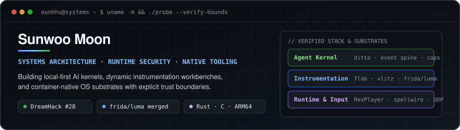

  

 

I build **local-first systems**, **dynamic instrumentation workbenches**, and **low-latency native runtimes**.  
Rather than stacking heavy frameworks over black-box runtimes, I focus on small executable cores, explicit capability boundaries, and behavior verified down to the instruction and packet level.

---

### Featured Open-Source Systems

<table>
  <tr>
    <td width="50%" valign="top">
      <h4><a href="https://github.com/eunhhu/ditto">ditto</a> · Local-First Agent Microkernel</h4>
      
Rust runtime for long-running personal AI agents built around an append-only event spine, scoped memory, content-addressed artifacts, and explicit effect permissions.

      
<code>Rust</code> · <code>Event Spine</code> · <code>Capability Security</code>

    </td>
    <td width="50%" valign="top">
      <h4><a href="https://github.com/eunhhu/flab">flab</a> · Runtime Instrumentation Workbench</h4>
      
Shared TypeScript &amp; Frida instrumentation engine driving a guided TUI, CLI, and MCP/ACP server with bounded session recording and automatic target cleanup.

      
<code>TypeScript</code> · <code>Frida</code> · <code>TUI / MCP</code> · <code>Android</code>

    </td>
  </tr>
  <tr>
    <td width="50%" valign="top">
      <h4><a href="https://github.com/eunhhu/RexPlayer">RexPlayer</a> · Container-Native Android Host</h4>
      
Native host and raw touchscreen input bridge for container-based Android 14 substrates across Linux and Windows/WSL2 without full VM overhead.

      
<code>Rust</code> · <code>Android 14</code> · <code>WSL2 / Linux</code>

    </td>
    <td width="50%" valign="top">
      <h4><a href="https://github.com/eunhhu/spellwire">spellwire</a> · <a href="https://github.com/eunhhu/remotepad">remotepad</a> · <a href="https://github.com/eunhhu/vlitz">vlitz</a></h4>
      
Low-latency native tooling suite in Rust: TypeScript-to-native hotkey &amp; overlay runtime (<code>spellwire</code>), binary UDP mobile input server (<code>remotepad</code>), and process debugger CLI (<code>vlitz</code>).

      
<code>Rust</code> · <code>Binary UDP</code> · <code>Win32 / Linux Input</code>

    </td>
  </tr>
</table>

---

### Upstream & Security Research

- **Frida Upstream (`frida/luma`):** Merged patches hardening runtime instrumentation error paths, build reliability, and OpenAI-compatible mission session providers ([PR #3](https://github.com/frida/luma/pull/3), [PR #4](https://github.com/frida/luma/pull/4)).
- **DreamHack Wargame:** Ranked **#28 overall** ([16,550 pts · 76 challenges solved](https://dreamhack.io/users/97873)), focusing on native binary reverse engineering, Android internals, and systems exploitation.
- **Current R&D:** Exploring deterministic native micro-runtimes and abstraction compression at [@yeowoo-labs](https://github.com/yeowoo-labs).
